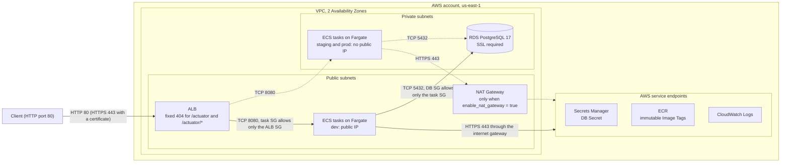

# AWS deployment (Terraform)

This directory deploys the Franchise Inventory API to AWS with Terraform.
It holds the Root Composition, five Terraform Modules, the Bootstrap Stack and the files for each Environment.

## Contents

1. [Overview](#overview)
2. [Architecture](#architecture)
3. [Repository layout](#repository-layout)
4. [Prerequisites](#prerequisites)
5. [Account inputs (never committed)](#account-inputs-never-committed)
6. [Runbook](#runbook)
7. [Key decisions and trade-offs](#key-decisions-and-trade-offs)
8. [IaC principles](#iac-principles)
9. [Quality checks](#quality-checks)
10. [Cost notes](#cost-notes)
11. [Known limits and future work](#known-limits-and-future-work)

## Overview

The API runs as a container on **ECS Fargate**.
The image comes from a private **ECR** repository.
An internet-facing **Application Load Balancer (ALB)** is the only public entry point.
Data lives in **RDS PostgreSQL 17**, the same engine as `docker-compose.yml`.
The database credentials live in one **Secrets Manager** secret, the DB Secret.
**Service Auto Scaling** adds or removes tasks to keep the average CPU near 75 percent.
Container logs go to **CloudWatch Logs**.

The Terraform code is modular:

- One Root Composition (`main.tf` and the files next to it) wires five Terraform Modules: `network`, `ecr`, `database`, `alb` and `ecs-service`.
- The Remote State lives in an S3 bucket with native S3 locking (`use_lockfile = true`). The Bootstrap Stack creates that bucket.
- Three Environments share the same code: `dev`, `staging` and `prod`. Each Environment has one `envs/<env>.tfvars` file and one `envs/<env>.backend.hcl` file.

Only `dev` is meant to be deployed.
`staging` and `prod` are complete and tested at plan level, but they are only parameterized.
All resources are in `us-east-1`.
Every resource name has the form `franchise-inventory-<env>-<resource>`, for example `franchise-inventory-dev-api`.

### Environments

| Setting | `dev` | `staging` | `prod` |
|---|---|---|---|
| VPC CIDR | `10.10.0.0/16` | `10.20.0.0/16` | `10.30.0.0/16` |
| NAT Gateway | no | yes (one) | yes (one) |
| Task subnets | public, with public IP | private, no public IP | private, no public IP |
| Capacity provider | `FARGATE_SPOT` | `FARGATE_SPOT` | `FARGATE` |
| Tasks (desired / min / max) | 1 / 1 / 2 | 1 / 1 / 2 | 2 / 2 / 4 |
| DB instance class | `db.t4g.micro` | `db.t4g.micro` | `db.t4g.small` |
| DB Multi-AZ | no | no | yes |
| DB storage autoscaling limit | off | 50 GB | 100 GB |
| DB backup retention | 1 day | 3 days | 7 days |
| DB deletion protection | off | off | on |
| DB final snapshot | skipped | kept | kept |
| DB Secret recovery window | 0 days | 7 days | 30 days |
| ECR force delete / images kept | yes / 10 | no / 10 | no / 30 |
| Log retention | 7 days | 14 days | 30 days |
| AWS Budget (USD 20) | yes | no | no |

The task size is the same in every Environment: 0.5 vCPU, 1 GB memory, `X86_64`.

## Architecture



Solid lines show `dev`.
Dashed lines show `staging` and `prod`, where the tasks run in private subnets behind the NAT Gateway.

How a request flows:

1. The client calls the ALB on port 80.
2. The ALB answers `404 Not Found` for `/actuator` and `/actuator/*`. It forwards every other path to a healthy task on port 8080.
3. At startup, each task reads the DB Secret from Secrets Manager. It then opens SSL connections to RDS on port 5432.
4. The ECS agent pulls the image from ECR and sends the container logs to CloudWatch Logs.

Security groups (SG) limit every hop:

- The ALB SG accepts the listener ports from `alb_allowed_ingress_cidrs` (default `0.0.0.0/0`). It sends traffic only to port 8080 inside the VPC.
- The task SG accepts port 8080 only from the ALB SG. This is true also in `dev`, where the tasks have a public IP. Its egress allows HTTPS (443) to the AWS endpoints and PostgreSQL (5432) to the DB SG.
- The DB SG accepts port 5432 only from the task SG. It has no egress rule.

There are no VPC endpoints, because they are billed per hour.
The tasks reach ECR, CloudWatch Logs and Secrets Manager through their public endpoints.

## Repository layout

```text
deployment/
├── Dockerfile                    # Multi-stage build of the API image (JRE 21, non-root user)
├── scripts/
│   └── publish-image.sh          # Builds the image and pushes it to ECR with the Image Tag
└── terraform/
    ├── bootstrap/                # Bootstrap Stack: the Remote State bucket (local state)
    ├── modules/
    │   ├── network/
    │   ├── ecr/
    │   ├── database/
    │   │   └── password/         # Ephemeral DB master password (see "Key decisions")
    │   ├── alb/
    │   └── ecs-service/
    ├── envs/
    │   ├── dev.tfvars      dev.backend.hcl
    │   ├── staging.tfvars  staging.backend.hcl
    │   └── prod.tfvars     prod.backend.hcl
    ├── tests/                    # terraform test files (mocked provider, plan only)
    │   ├── dev.tftest.hcl  staging.tftest.hcl  prod.tftest.hcl
    │   └── inputs.tftest.hcl
    ├── main.tf                   # Root Composition: wires the modules
    ├── budget.tf                 # AWS Budget (dev only)
    ├── variables.tf  outputs.tf  providers.tf  versions.tf
    ├── .terraform.lock.hcl       # Provider version and checksums
    └── .tflint.hcl
```

### What each part owns

| Part | Owns |
|---|---|
| `bootstrap/` | The S3 bucket `franchise-inventory-tfstate-<account_id>` for the Remote State: versioning, AES256 encryption, a public access block and `BucketOwnerEnforced` ownership. It uses local state. Output: `state_bucket`. |
| `modules/network` | The VPC over `az_count` Availability Zones, the internet gateway, one public and one private subnet per AZ (`/20` blocks), the route tables, and one optional NAT Gateway with its Elastic IP. |
| `modules/ecr` | One private repository per Environment with `IMMUTABLE` tags, scan on push, AES256 encryption and a lifecycle policy. The policy expires untagged images after 1 day and keeps the `max_image_count` most recent images. |
| `modules/database` | The DB subnet group, the DB SG, the RDS instance (gp3, encrypted, not public) and the DB Secret with its version. The nested `password` module generates the ephemeral master password. |
| `modules/alb` | The ALB SG, the ALB, the target group (type `ip`, health check `/actuator/health/readiness`), the HTTP listener, the optional HTTPS listener, and the listener rule that answers 404 for the actuator. |
| `modules/ecs-service` | The cluster, the log group, the execution role, the task role, the task SG, the task definition, the service, and the Service Auto Scaling target and CPU policy. The task definition, the service and the scaling resources exist only when an Image Tag is set. |
| Root Composition | Wires the modules, sets the provider `default_tags` (`Project`, `Environment`, `ManagedBy`, `Repository`), holds the AWS Budget (`budget.tf`) and exposes the outputs. |

### Root outputs

| Output | Content |
|---|---|
| `alb_url` | Base URL of the API through the ALB (`http://<dns>`, or `https://<dns>` with a certificate). |
| `ecr_repository_url` | URL of the Environment's ECR repository. |
| `ecr_repository_name` | Name of the ECR repository. |
| `container_image` | Full image reference that the Environment deploys. Null without `image_tag`. |
| `db_secret_name` | Name of the DB Secret. |
| `ecs_cluster_name` | Name of the ECS cluster. |
| `ecs_service_name` | Name of the ECS service. Null without `image_tag`. |
| `ecs_log_group_name` | CloudWatch log group of the API container. |

## Prerequisites

- **Terraform** `>= 1.11, < 2.0` (see `versions.tf`). Version 1.11 is the first version with write-only arguments.
- **AWS CLI v2**.
- **Docker**. The publish script builds a `linux/amd64` image. On an ARM machine, Docker builds it through emulation, which is slower.
- **git**. The publish script reads the commit SHA.
- **tflint**, for the quality checks only.
- An **AWS account** and a credentials profile with permission to create the resources in this directory.

The examples use `bash` syntax.
In `fish`, write `set -x NAME value` in place of `export NAME=value`, and `(command)` in place of `$(command)`.

## Account inputs (never committed)

The repository holds no account ID, no profile name and no personal email.
Give these three values on your machine only:

| Input | Where it is used | How to set it |
|---|---|---|
| `AWS_PROFILE` | Every Terraform and AWS CLI command. The providers never set `profile`. | `export AWS_PROFILE=<your-profile>` |
| State bucket name | `terraform init` of the Root Composition. | Read the `state_bucket` output of the Bootstrap Stack. Pass it with `-backend-config="bucket=..."`. |
| `TF_VAR_budget_alert_email` | `budget_alert_email` variable. Required in `dev`, because `enable_budget = true`. | `export TF_VAR_budget_alert_email=<your-email>` |

Set `TF_VAR_budget_alert_email` before every `plan`, `apply` and `destroy` in `dev`.
Without it, the variable validation fails.

## Runbook

All paths are relative to the repository root, unless a step says otherwise.
The runbook deploys `dev`.
For another Environment, replace `dev` with `staging` or `prod` in every file name and argument.

### 1. Set the account inputs

```bash
export AWS_PROFILE=<your-profile>
export TF_VAR_budget_alert_email=<your-email>
aws sts get-caller-identity
```

Check that the account in the output is the account you want to use.

### 2. Create the Remote State bucket (Bootstrap Stack)

Run this step once per AWS account.

```bash
cd deployment/terraform
terraform -chdir=bootstrap init
terraform -chdir=bootstrap apply
terraform -chdir=bootstrap output -raw state_bucket
```

The output is the bucket name, `franchise-inventory-tfstate-<account_id>`.

The Bootstrap Stack keeps its own state in `bootstrap/terraform.tfstate` on your machine.
git ignores this file.
Keep it, because you need it to destroy the bucket later.

### 3. Initialize the Root Composition

Run this from `deployment/terraform`.

```bash
terraform init \
  -backend-config=envs/dev.backend.hcl \
  -backend-config="bucket=$(terraform -chdir=bootstrap output -raw state_bucket)"
```

`envs/dev.backend.hcl` sets the state key `franchise-inventory/dev/terraform.tfstate`, the region, encryption and `use_lockfile = true`.
The bucket name comes only from the command line.

To switch to another Environment in the same directory, run `init` again with that Environment's backend file and add `-reconfigure`.

### 4. First apply, without an Image Tag

The ECS service needs an image, and the image needs the ECR repository.
So the first apply runs without `image_tag`.

```bash
terraform plan -var-file=envs/dev.tfvars
terraform apply -var-file=envs/dev.tfvars
```

This apply creates the ECR repository, the network, the database and the DB Secret, the ALB, the ECS cluster, the log group, the IAM roles, the task SG and the AWS Budget.
It creates no task definition, no ECS service and no scaling resources yet.
The RDS instance takes several minutes to create.

### 5. Publish the image

Run this from the repository root.

```bash
IMAGE_TAG=$(deployment/scripts/publish-image.sh dev)
echo "$IMAGE_TAG"
```

The script does these steps:

1. It checks that `aws`, `docker` and `git` are installed.
2. It refuses to run when the working tree has uncommitted changes. The Image Tag is the commit SHA, so a dirty tree would give an image that does not match its tag.
3. It sets the Image Tag to the 12-character short SHA of `HEAD`.
4. It checks that the repository `franchise-inventory-dev-api` exists. It stops if the Image Tag already exists in it, because tags are immutable.
5. It logs in to ECR, builds `deployment/Dockerfile` for `linux/amd64` and pushes the image.
6. It prints the Image Tag on the last line of stdout. All logs go to stderr, so `$(...)` captures only the tag.

Script settings:

| Variable | Effect |
|---|---|
| `AWS_PROFILE` | Credentials profile. Optional; otherwise the default credential chain is used. |
| `AWS_REGION` | Region of the ECR repository. Default: `us-east-1`. |
| `ALLOW_DIRTY=1` | Publish even with uncommitted changes. The image then does not match the commit in its tag. Use it only for tests. |

The Docker build skips the tests (`-x test`).
Run `./gradlew test` before you publish.

If the script says that the Image Tag already exists, you do not need to publish again.
Use that tag in the next step.

### 6. Apply with the Image Tag

Run this from `deployment/terraform`.

```bash
terraform apply -var-file=envs/dev.tfvars -var image_tag="$IMAGE_TAG"
```

This apply creates the task definition, the ECS service and the Service Auto Scaling resources.
`apply` returns when ECS accepts the deployment. It does not wait for healthy tasks.
The service ignores failed health checks for 120 seconds after a task starts, so Flyway can run the migrations.

Follow the deployment:

```bash
aws ecs describe-services \
  --cluster "$(terraform output -raw ecs_cluster_name)" \
  --services "$(terraform output -raw ecs_service_name)" \
  --query 'services[0].deployments'
aws logs tail "$(terraform output -raw ecs_log_group_name)" --follow
```

> **Important:** after this step, pass `-var image_tag=<tag>` to every `plan` and `apply`.
> Without it, Terraform plans to delete the task definition, the service and the scaling resources.
> Run `terraform output -raw container_image` to see the image that is deployed now.

### 7. Smoke test through the ALB

Run this from `deployment/terraform`.
A new ALB DNS name can take a few minutes to resolve.

```bash
ALB_URL=$(terraform output -raw alb_url)
```

Create a Franchise. Expect `201 Created`, a `Location` header and a JSON body with `id` and `name`:

```bash
curl -i -X POST "$ALB_URL/franchises" \
  -H 'Content-Type: application/json' \
  -d '{"name":"Smoke Test Franchise"}'
```

Copy the `id` from the response. Add a Branch to the Franchise. Expect `201 Created`:

```bash
FRANCHISE_ID=<id-from-the-response>
curl -i -X POST "$ALB_URL/franchises/$FRANCHISE_ID/branches" \
  -H 'Content-Type: application/json' \
  -d '{"name":"Downtown"}'
```

Copy the Branch `id`. Add a Product to the Branch. Expect `201 Created`:

```bash
BRANCH_ID=<id-from-the-response>
curl -i -X POST "$ALB_URL/franchises/$FRANCHISE_ID/branches/$BRANCH_ID/products" \
  -H 'Content-Type: application/json' \
  -d '{"name":"Coffee","stock":10}'
```

Copy the Product `id`. Delete the Product. Expect `204 No Content`:

```bash
PRODUCT_ID=<id-from-the-response>
curl -i -X DELETE "$ALB_URL/franchises/$FRANCHISE_ID/branches/$BRANCH_ID/products/$PRODUCT_ID"
```

Send the first request again. Expect `409 Conflict`, because Franchise names are unique.
This shows that the data is stored in RDS.

Check that the ALB hides the actuator. Expect `404 Not Found` from both requests:

```bash
curl -i "$ALB_URL/actuator"
curl -i "$ALB_URL/actuator/health"
```

The ALB health check still reaches `/actuator/health/readiness`, because it calls each task directly and does not pass through the listener.

### 8. Deploy a new version

1. Commit the change.
2. Publish the new image from the repository root:

   ```bash
   IMAGE_TAG=$(deployment/scripts/publish-image.sh dev)
   ```

3. Apply the new Image Tag from `deployment/terraform`:

   ```bash
   terraform apply -var-file=envs/dev.tfvars -var image_tag="$IMAGE_TAG"
   ```

Each new Image Tag creates a new task definition revision.
ECS starts the new tasks first (up to 200 percent) and keeps all old tasks until the new tasks are healthy (100 percent minimum).
If the new tasks never become healthy, the deployment circuit breaker rolls the service back to the last working revision.
After a rollback, fix the code and publish a new Image Tag, or apply the previous Image Tag again.

To roll back by hand, apply an older Image Tag.
The ECR lifecycle policy keeps the 10 most recent images in `dev`.

### 9. Rotate the DB password

There is no automatic rotation.
To rotate the password by hand:

1. Add `db_password_version = 2` to `envs/dev.tfvars`. Use the next number for each later rotation. Commit the change, so the version is never applied back to an old value.
2. Apply with the current Image Tag:

   ```bash
   terraform apply -var-file=envs/dev.tfvars -var image_tag=<current-tag>
   ```

   RDS and the DB Secret get the new password in the same apply. The same apply also writes the current host and port to the DB Secret.
3. Start a new ECS deployment. The app reads the DB Secret only at startup, so the running tasks keep the old password:

   ```bash
   aws ecs update-service \
     --cluster "$(terraform output -raw ecs_cluster_name)" \
     --service "$(terraform output -raw ecs_service_name)" \
     --force-new-deployment
   ```

### 10. Destroy

Destroy the Root Composition first. Destroy the Bootstrap Stack last.

**a. Destroy the Environment.** Run this from `deployment/terraform`, with `TF_VAR_budget_alert_email` set:

```bash
terraform destroy -var-file=envs/dev.tfvars
```

In `dev`, this removes everything without a manual step:

- `ecr_force_delete = true`, so the repository is deleted with its images.
- `db_skip_final_snapshot = true`, so RDS takes no final snapshot.
- `db_secret_recovery_window_days = 0`, so Secrets Manager deletes the DB Secret at once. The next apply can create a secret with the same name.

In `staging` and `prod`, the settings protect the data, so destroy needs more steps:

- `prod` has `db_deletion_protection = true`. Set it to `false` and apply before you destroy.
- `ecr_force_delete = false`. Delete the images in the repository first, or destroy fails.
- RDS takes a final snapshot with a fixed name: `franchise-inventory-<env>-db-final`. If that snapshot still exists from an earlier destroy, the next destroy fails. Delete the old snapshot first:

  ```bash
  aws rds delete-db-snapshot --db-snapshot-identifier franchise-inventory-prod-db-final
  ```

- The DB Secret has a recovery window (7 days in `staging`, 30 days in `prod`). During this window, the name `franchise-inventory-<env>-db` stays reserved, and a new apply cannot create the secret. To free the name at once, run:

  ```bash
  aws secretsmanager delete-secret \
    --secret-id franchise-inventory-prod-db \
    --force-delete-without-recovery
  ```

**b. Empty the state bucket.**
The bucket has versioning on and `force_destroy = false`.
`terraform destroy` cannot delete a bucket that still holds objects or old object versions.
Delete every object version, then every delete marker.
Run this from `deployment/terraform`:

```bash
BUCKET=$(terraform -chdir=bootstrap output -raw state_bucket)

aws s3api list-object-versions --bucket "$BUCKET" --output json \
  --query '{Objects: Versions[].{Key: Key, VersionId: VersionId}}' > versions.json
aws s3api delete-objects --bucket "$BUCKET" --delete file://versions.json

aws s3api list-object-versions --bucket "$BUCKET" --output json \
  --query '{Objects: DeleteMarkers[].{Key: Key, VersionId: VersionId}}' > markers.json
aws s3api delete-objects --bucket "$BUCKET" --delete file://markers.json

rm versions.json markers.json
```

If a JSON file shows `"Objects": null`, there is nothing to delete. Skip its `delete-objects` command.
You can also use **Empty** on the bucket page of the S3 console.

**c. Destroy the Bootstrap Stack.**

```bash
terraform -chdir=bootstrap destroy
```

## Key decisions and trade-offs

### The app reads the DB Secret itself

- The ECS task gets only three non-secret environment variables: `SPRING_PROFILES_ACTIVE=aws`, `DB_SECRET_NAME` and `AWS_REGION`. The task definition has no `secrets` block.
- In the `aws` Spring profile (`applications/app-service/src/main/resources/application-aws.yaml`), Spring Cloud AWS imports the DB Secret at startup with `aws-secretsmanager:${DB_SECRET_NAME}?prefix=db.`. The secret keys `host`, `port`, `dbname`, `username` and `password` become `db.host`, `db.port` and so on. The profile maps them to `adapters.r2dbc.*`.
- The task role can call only `secretsmanager:GetSecretValue`, and only on the DB Secret ARN.
- Trade-off: the app reads the secret once. A new password reaches the app only after a new ECS deployment.

Result: no credential is in the code, in a container environment variable or in the task definition.

### The password never enters the Terraform state

- The nested module `modules/database/password` generates the password with an ephemeral resource (`aws_secretsmanager_random_password`). Terraform never stores ephemeral values in the plan or the state.
- Terraform sends the password only to write-only arguments: `password_wo` on the RDS instance and `secret_string_wo` on the secret version. Terraform sends these values and does not keep them.
- Both writes use `db_password_version` as their version. Terraform sends a write-only value only when its version changes, so RDS and the DB Secret always get the same password in the same apply.
- The root has a second provider configuration, `aws.db_password` (same account and region). It exists only because `terraform test` cannot mock ephemeral resources. The tests mock the default provider and replace the password module with `override_module`. The production behavior is the same.
- Trade-off: Terraform writes the DB Secret JSON only when `db_password_version` changes. If the RDS host or port changes later (for example, the instance is replaced), the DB Secret keeps the old values until you increase `db_password_version`. That apply also rotates the password.

### Public subnets in place of a NAT Gateway in `dev`

A NAT Gateway is billed per hour, even when idle.
In `dev`, the tasks run in the public subnets with a public IP (`tasks_in_private_subnets = false`, `enable_nat_gateway = false`).
The task SG still accepts traffic only from the ALB SG, so nobody can reach a task directly.
RDS always stays in the private subnets.
`staging` and `prod` set both variables to `true`. A variable validation rejects private tasks without a NAT Gateway, because those tasks could not pull the image.
There is only one NAT Gateway, not one per AZ. This keeps the cost down, but private egress stops if that AZ fails.

### Environments through tfvars and backend files, not workspaces

Each Environment has its own `envs/<env>.tfvars` and `envs/<env>.backend.hcl`.
Each one has its own state key in the bucket.
You can read all differences between Environments in these files, and code review shows every change to them.
With workspaces, the Environment would be hidden state on the machine of the person who runs Terraform, and one wrong `workspace select` could change the wrong Environment.

### Fargate Spot in `dev` and `staging`

Fargate Spot costs much less than regular Fargate.
AWS can reclaim a Spot task. ECS then starts a new one, so the API has a short gap.
This is acceptable in `dev` and `staging`.
`prod` uses regular `FARGATE`, so Spot reclaims never interrupt it.

### The actuator is blocked at the ALB

The app exposes `health` and `prometheus` on the actuator.
A listener rule with priority 1 answers a fixed `404` for `/actuator` and `/actuator/*`, so health and metrics data are not public.
The target group health check calls `/actuator/health/readiness` directly on each task, so the rule does not affect it.

### Other security settings

- **SSL to RDS:** the `aws` profile sets `ssl-mode: require` for R2DBC and Flyway. The default RDS parameter group for PostgreSQL 15 and later sets `rds.force_ssl = 1`, so RDS also rejects connections without SSL.
- **CORS closed:** no frontend is planned, so the `aws` profile sets `cors.allowed-origins` to an empty list. No browser origin can call the API.
- **Least-privilege IAM:** the execution role can only pull from the Environment's ECR repository and write to its log group. The task role can only read the DB Secret. No AWS managed policy is attached. ECS Exec is off, so no SSM permission exists.
- **ALB hardening:** `drop_invalid_header_fields = true`. With a certificate, HTTP redirects to HTTPS with the policy `ELBSecurityPolicy-TLS13-1-2-2021-06`.

### Spring Cloud AWS and Spring Boot versions

The app uses Spring Cloud AWS `4.2.0` with Spring Boot `4.1.1`.
Spring Cloud AWS 4.2.0 officially lists Spring Boot 4.0.x.
The build and the tests (`./gradlew vs test`) pass with Boot 4.1.1.
Check this pair again when you upgrade either library.

## IaC principles

### Reproducibility

- `versions.tf` pins Terraform to `>= 1.11, < 2.0` and the AWS provider to `~> 6.0`.
- The lock files (`.terraform.lock.hcl` and `bootstrap/.terraform.lock.hcl`) are committed. They pin `hashicorp/aws` to an exact version, with checksums for `linux_amd64`, `darwin_arm64` and `darwin_amd64`. To add another platform, run `terraform providers lock -platform=<os_arch>` and commit the result.
- `.tflint.hcl` pins the AWS ruleset plugin version.
- The test files rebuild every Environment's plan with no AWS account.

### Idempotency

- After an apply, a second `plan` with the same tfvars and the same `image_tag` must show `No changes`.
- Service Auto Scaling owns the task count after the first apply. The ECS service has `ignore_changes = [desired_count]`, so a later plan never resets a scale-out.
- The write-only password arguments cause no diff. They change only when `db_password_version` changes.

### Versioning

- The Image Tag is the git commit SHA, and the ECR tags are `IMMUTABLE`. One Image Tag always means the same image, so a deployment is traceable to one commit.
- The infrastructure code, the Environment files, the tests and the lock files are all in git.
- The Remote State bucket keeps old versions of every state file.

## Quality checks

Run all checks from `deployment/terraform`.
They need no AWS account.

```bash
# Formatting of every .tf and .tfvars file
terraform fmt -check -recursive

# Root Composition: download the providers without the backend, then validate
terraform init -backend=false
terraform validate

# Plan-level tests (mocked AWS provider)
terraform test

# Bootstrap Stack
terraform -chdir=bootstrap init -backend=false
terraform -chdir=bootstrap validate

# Lint every directory, including the modules and the Bootstrap Stack
tflint --init
tflint --recursive
```

What `terraform test` covers:

- Every test uses a mocked AWS provider and `command = plan`. No test calls AWS.
- There is one test file per Environment: `tests/dev.tftest.hcl`, `tests/staging.tftest.hcl` and `tests/prod.tftest.hcl`. `terraform test` cannot load a `-var-file`, so each file repeats the values of its `envs/<env>.tfvars`. **When you change a tfvars file, change its test file in the same commit.**
- Each Environment file plans twice: once without an Image Tag (first apply) and once with an Image Tag (service). It asserts the network layout, the ECR settings, the RDS settings, the DB Secret, the SG rules, the IAM policy scope, the absence of credentials in the container environment, the actuator rule, the capacity provider, the scaling settings and the budget.
- `tests/inputs.tftest.hcl` tests the variable validations (for example, an invalid `image_tag`, private tasks without a NAT Gateway, or a missing budget email) and the optional paths (HTTPS with a certificate, restricted ALB ingress).

No other scanners (for example checkov or trivy) are used.
The agreed scope is these four checks, and the plan-level tests already assert the security rules that matter here: IAM scope, no credentials and network exposure.

## Cost notes

The target is a new AWS Free plan account with limited credits.
The spec did not confirm that the Free plan allows ECS, RDS and ALB.
These resources cost money while `dev` runs:

- **ALB:** billed per hour and per load balancer capacity unit, even with no traffic.
- **RDS:** the `db.t4g.micro` instance is billed per hour. The 20 GB of gp3 storage and the backups are billed per month.
- **Fargate Spot:** billed per vCPU-hour and per GB-hour, for 1 task (up to 2 under load) of 0.5 vCPU and 1 GB.
- **Public IPv4 addresses:** billed per hour. The ALB uses one per AZ, and each `dev` task has one.
- **NAT Gateway:** billed per hour and per GB processed, plus its Elastic IP. Only `staging` and `prod` enable it.
- **Small items:** CloudWatch Logs ingestion and storage (7 days), ECR storage (10 images at most), the DB Secret, and the S3 state bucket.

Container Insights is off, and there are no VPC endpoints, to avoid more hourly or metric charges.

`dev` creates an AWS Budget of USD 20 per month.
It emails `TF_VAR_budget_alert_email` when the actual spend passes 50, 80 and 100 percent.
The budget only sends alerts. It does not stop any resource.
Destroy `dev` when you do not use it.

## Known limits and future work

- **No automatic secret rotation and no runtime reload.** Rotation is the manual `db_password_version` step. The app reads the DB Secret only at startup, so a rotation needs a new ECS deployment.
- **No HTTPS domain.** The ALB serves HTTP on port 80. Set `alb_certificate_arn` to an ACM certificate ARN to add HTTPS on port 443 with a redirect from HTTP.
- **No `verify-full` SSL.** The app uses `require`: the connection is encrypted, but the app does not verify the RDS certificate against the RDS CA bundle.
- **No CI/CD pipeline.** A developer runs Terraform by hand. `publish-image.sh` is non-interactive, writes logs to stderr and prints only the Image Tag, so a CD pipeline can call it later.
- **Fixed final snapshot name.** In `staging` and `prod`, a second destroy fails until the old `franchise-inventory-<env>-db-final` snapshot is deleted.
- **DB Secret host and port refresh only with the password version** (see "Key decisions").
- **No rate limiting at the edge.** The ALB has no AWS WAF web ACL. A later option is an optional WAF web ACL with a rate-based rule on the ALB, behind a variable that is off by default, because WAF adds a monthly charge.
- **Base images are not pinned by digest.** The Dockerfile uses the `eclipse-temurin:21-jdk-alpine` and `eclipse-temurin:21-jre-alpine` tags, so two builds of the same commit can use different base layers.
